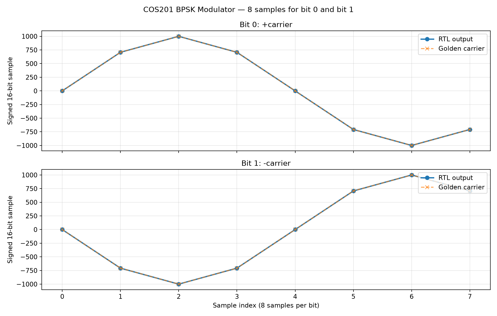
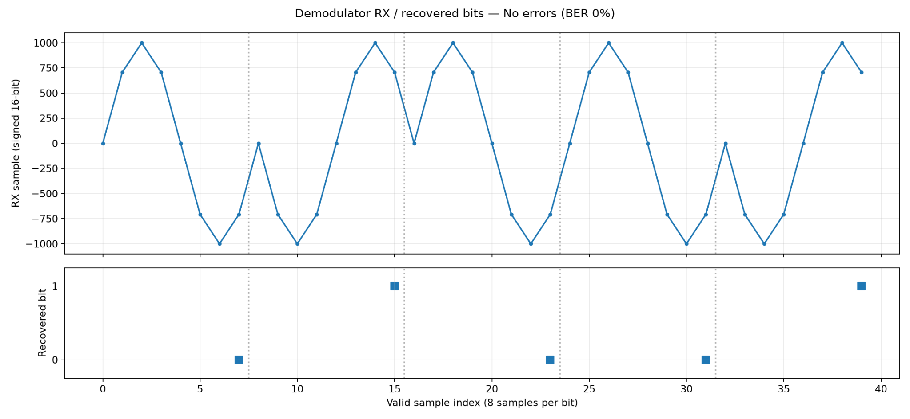

# BPSK Modulator and Demodulator using Verilog HDL

**COS201 — Communication Systems | Digital BPSK RTL and Functional Verification**

This student project implements a digital **Binary Phase Shift Keying (BPSK)** communication chain in Verilog HDL. It maps each input bit to eight signed carrier samples, optionally injects a controlled symbol error, recovers the bit using correlation, and counts bit errors. A Python Golden Model supplies the expected sample and bit sequences for self-checking RTL simulation.

> **Scope:** Functional RTL simulation. The channel is a deterministic sign-inversion model, **not** an AWGN/real-RF channel. No FPGA or ASIC implementation is claimed.

## Architecture / top-down design


```text
Binary data (data_bit, data_valid)
              |
              v
    +-------------------+
    | BPSK Modulator    |  bit 0 => +LUT, bit 1 => -LUT
    +-------------------+
              | 8 signed 16-bit samples per bit
              v
    +-------------------+
    | Controlled Channel|  optional inversion of selected symbol
    +-------------------+
              | 8 received samples
              v
    +-------------------+
    | BPSK Demodulator  |  8-sample correlation -> recovered bit
    +-------------------+
              | recovered_bit, bit_valid
              v
    +-------------------+
    | BER Counter       |  compares recovered bits with stored TX bits
    +-------------------+
              | total_bits, error_bits
```

**Top-down implementation:** system specification → block diagram and module interfaces → individual RTL modules → top-level integration → standalone unit tests → Python Golden Model / self-checking testbench → result review.

## Design specifications

| Property | Implementation |
|---|---|
| Modulation | BPSK: `0 → +carrier`, `1 → −carrier` |
| Carrier LUT | `[0, 707, 1000, 707, 0, -707, -1000, -707]` |
| Samples per symbol | 8 |
| Sample representation | Signed 16-bit |
| Demodulation | Signed correlation of 8 received samples and reference LUT; negative sum → bit 1, otherwise bit 0 |
| Channel | Pass-through or sign-inversion of one selected symbol index |
| BER | `error_bits / total_bits` calculated from RTL output counters |
| Reset | Active-high |
| Input contract | `data_valid` pulses only while modulator is idle; no ready/valid handshake |

### RTL modules

| File | Purpose |
|---|---|
| `rtl/bpsk_modulator.v` | Generate eight BPSK samples per accepted bit |
| `rtl/channel.v` | One-stage registered sample path and controlled inversion |
| `rtl/bpsk_demodulator.v` | Correlate valid samples and output a decoded bit |
| `rtl/ber_counter.v` | Match TX/RX bits using a 16-entry FIFO; count total/errors |
| `rtl/bpsk_top.v` | Integrate the complete chain |

## Repository structure

```text
rtl/                    Synthesizable Verilog modules
tb/                     Self-checking system + Channel/BER unit tests
model/golden_model.py   Independent Python reference generator
model/reference/        Generated test vectors, expected samples and cases
verification_support/   Verification fixture and plot-generation helpers
docs/                   Architecture, specifications, design and report
run_tests.ps1           PowerShell entry point for Icarus-based verification
run_tests.py            Python test runner
```

## How to simulate

Run the commands **from the repository root** on Windows. The two flows use different simulators.

### Option A — ModelSim / QuestaSim (verified on 01 November 2026)

Install ModelSim/QuestaSim so `vlog` and `vsim` are available in your terminal. In PowerShell:

```powershell
New-Item -ItemType Directory -Force simulation/results | Out-Null
vlog -sv +incdir+. rtl/bpsk_modulator.v rtl/channel.v rtl/bpsk_demodulator.v rtl/ber_counter.v rtl/bpsk_top.v tb/tb_bpsk_system.v
vsim -c tb_bpsk_system -do "run -all; quit -f"
```

The testbench loads reference memories from `model/reference/` and compares RTL TX samples, channel RX samples, recovered bits, and BER counters. The output includes `TEST PASS: 17 cases; scope=team_rtl` when all currently defined cases pass.

**Most recent recorded result:** On **2026-11-01**, the integrated ModelSim run reported **17/17 PASS, 0 errors, 0 warnings** for the tested scenarios. Re-run before submission if RTL/reference files have changed.

### Option B — Icarus Verilog + Python (scripted runner)

Requirements: Python 3, `iverilog`, and `vvp` on PATH. Optional: `matplotlib` for PNG charts.

```powershell
python run_tests.py
# or
.\run_tests.ps1
```

The script regenerates `model/reference/` and writes output under `simulation/results/team_rtl/`, including a CSV table, logs and optional plots. **A successful past ModelSim run does not automatically validate the Icarus script on your own machine; run this command to verify it.**

> CAUTION: The Golden Model regenerates data in `model/reference/`. Do not run an alternative 16-bit demonstration script from an older member branch over the official reference data.

## Verification and evidence

- Independent Golden Model: `model/golden_model.py`
- End-to-end self-checking TB: `tb/tb_bpsk_system.v`
- Module tests: `tb/tb_channel.v`, `tb/tb_ber_counter.v`
- Representative cases: all-zero/all-one, alternating bits, error first/middle/last/outside range, randomized patterns, input gaps, reset, 256/300-symbol sequences, idle.
- **Recorded integrated result:** 17/17 test cases PASS (ModelSim, 2026-11-01; Errors: 0, Warnings: 0; 72,160 ns simulation).
- **Member 1 evidence:** Modulator bit 0 and bit 1 each passed eight expected sample checks in the submitted CSV.
- **Member 2 evidence:** Both standalone demodulator scenarios passed. The clean scenario recovered 16 bits with 0 errors (BER = 0%). The single-error scenario inverted symbol index 3, resulting in 1 error out of 16 bits (BER = 6.25%). Both scenarios reported zero RTL mismatches. See [Demodulator and BER Verification](docs/demodulator_ber_explanation.md).

### Illustrations

**Modulator: RTL output compared with the reference carrier**



**Demodulator: representative no-error waveform**



## Documentation

- [Block diagram and system description](docs/block_diagram.md)
- [System specification](docs/system_specification.md)
- [Interface specification](docs/interface_specification.md)
- [Channel design](docs/channel_design.md)
- [BER design](docs/ber_design.md)
- [Task tracking](docs/task_tracking.md)
- [Project report (editable Word)](docs/COS201_BPSK_Final_Report.docx)

## Limitations / future work

The initial system does not support AWGN, coherent carrier recovery, synchronization, hardware deployment, or a modulator input-ready handshake. The channel uses an 8-bit symbol index (wraps after 256), and the BER counter stores at most 16 unpaired TX bits. The RTL reports integer counters rather than a floating-point BER output. Current integrated cases are **not** exhaustive verification of all possible timing and error patterns.

## Contributors

Four-person COS201 course team: project lead/integration; Modulator; Demodulator; Verification. Member contributions are preserved in the Git history and Pull Requests.
