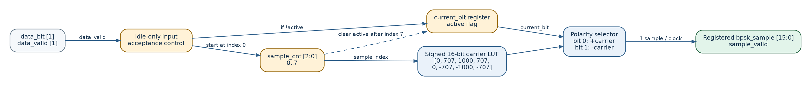
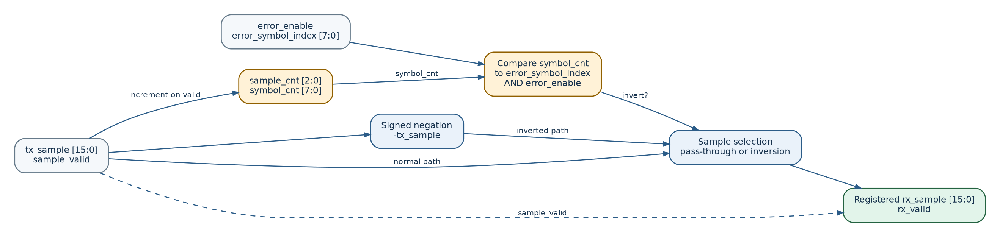
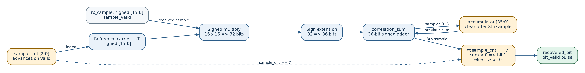
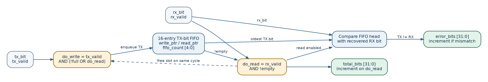

# COS201 — RTL Detailed Design

**Project:** BPSK Modulator and Demodulator using Verilog HDL
**Design level:** Implemented digital RTL, not analog RF or FPGA deployment
**Source of truth:** `rtl/bpsk_top.v` and its four instantiated modules on the `main` baseline

## 1. Top-down module decomposition

The implemented communication chain contains four processing modules under `bpsk_top`: the Modulator, the controlled Channel, the Demodulator, and the BER Counter. The same `clk` and active-high asynchronous `reset` reach all four modules. The Modulator and Channel exchange a signed 16-bit sample plus a validity signal; the Channel and Demodulator use the same interface. The BER Counter receives the original transmitted bit and the recovered bit and outputs **integer counts**; the BER ratio is calculated in verification/reporting, not by a floating-point RTL divider.

| Module | Main inputs | Main outputs | Internal implementation |
|---|---|---|---|
| `bpsk_modulator` | `data_bit`, `data_valid` | signed `bpsk_sample[15:0]`, `sample_valid` | `active`, `current_bit`, 3-bit sample counter and 8-entry carrier LUT |
| `channel` | signed `tx_sample[15:0]`, `sample_valid`, `error_enable`, `error_symbol_index[7:0]` | signed `rx_sample[15:0]`, `rx_valid` | 3-bit sample counter, 8-bit symbol counter, conditional sign inversion and output registers |
| `bpsk_demodulator` | signed `rx_sample[15:0]`, `sample_valid` | `recovered_bit`, `bit_valid` | 8-entry carrier LUT, signed 16-by-16 multiplier, 36-bit accumulator and sign decision |
| `ber_counter` | `tx_bit`, `tx_valid`, `rx_bit`, `rx_valid` | `total_bits[31:0]`, `error_bits[31:0]` | 16-entry TX FIFO, read/write pointers, 5-bit occupancy and comparison counters |

The top level exposes `data_bit`, `data_valid`, `error_enable`, and `error_symbol_index` as control/data inputs; the recovered bit, `bit_valid`, and both counters are public outputs. The signed TX/RX sample signals are **internal wires**, available to the integration testbench through hierarchy (`dut.tx_sample`, `dut.rx_sample`).

## 2. BPSK Modulator — detailed architecture

**RTL:** [`rtl/bpsk_modulator.v`](../rtl/bpsk_modulator.v)

1. A one-cycle `data_valid` pulse is accepted **only while `active == 0`**. The bit is captured into `current_bit` and `active` is asserted.
2. The first registered sample (LUT index 0, value zero) is emitted on the accepting clock edge. The remaining indices 1–7 are emitted on subsequent rising edges while `active == 1`.
3. The carrier LUT is `C = [0, 707, 1000, 707, 0, -707, -1000, -707]`. For bit `0`, `TX[k] = C[k]`; for bit `1`, `TX[k] = -C[k]`.
4. After sample index 7 the controller clears `active` and resets the sample counter. `sample_valid` is asserted with each of the eight registered samples.
5. `data_valid` asserted during `active == 1` is ignored. There is **no ready/valid handshake or input FIFO**.

**Reset behavior:** `active`, `sample_cnt`, `current_bit`, `bpsk_sample`, and `sample_valid` are cleared on active-high asynchronous reset.

## 3. Controlled Channel — detailed architecture

**RTL:** [`rtl/channel.v`](../rtl/channel.v)

1. The 3-bit `sample_cnt` advances only for an input with `sample_valid == 1`. After eight valid samples, it wraps to zero and the 8-bit `symbol_cnt` increments.
2. When `error_enable == 1` and `symbol_cnt == error_symbol_index`, every valid sample in that symbol is sign-inverted: `RX[k] = -TX[k]`. Otherwise, `RX[k] = TX[k]`.
3. The `rx_sample` and `rx_valid` outputs are registered together. Relative to the registered Modulator output, the Channel adds one pipeline stage.
4. Invalid cycles produce `rx_valid = 0` and `rx_sample = 0`; counters do not advance.

**Important limitations:** The symbol index is only 8 bits and wraps after 256 symbols. Error control is evaluated for **each valid sample**, not latched at a symbol boundary: keep `error_enable` and `error_symbol_index` stable throughout a symbol to obtain the intended full-symbol inversion. This is a deterministic channel, **not AWGN**.

## 4. BPSK Demodulator — detailed architecture

**RTL:** [`rtl/bpsk_demodulator.v`](../rtl/bpsk_demodulator.v)

1. For each valid received sample, select the same reference LUT value `C[k]` from the local carrier function using the 3-bit `sample_cnt`.
2. Multiply signed 16-bit RX and reference samples to produce a **signed 32-bit `product`**. Sign-extend the product to **36 bits** before adding it to the signed `accumulator`.
3. On valid indices 0–6, store `correlation_sum = accumulator + product_ext` and advance the counter. Invalid input cycles neither modify the accumulator nor advance the sample counter.
4. On the eighth valid sample (index 7), evaluate the **current** `correlation_sum`, output `recovered_bit = 1` if the sum is negative, otherwise bit `0`, and assert `bit_valid` for one clock cycle. Then clear the accumulator and sample counter for the next symbol.

**Correlation rule:**

`S = sum(RX[k] * C[k]), k = 0..7`
`recovered_bit = 1 if S < 0, else 0`

For the ideal LUT, `sum(C[k]^2) = 3,999,396`: the expected correlation for a clean bit `0` is `+3,999,396` and for a clean bit `1` is `-3,999,396`. Inverting the received symbol reverses the decision sign.

**Reset behavior:** `sample_cnt`, `accumulator`, `recovered_bit`, and `bit_valid` are cleared on active-high asynchronous reset. The demodulator assumes valid samples are ordered and that transmitter and receiver use the same fixed carrier reference; it does **not** recover an unknown carrier phase.

## 5. BER Counter — detailed architecture

**RTL:** [`rtl/ber_counter.v`](../rtl/ber_counter.v)

1. A **16-entry, one-bit FIFO** holds transmitted bits until the corresponding recovered bits arrive. Four-bit read and write pointers wrap over the 16 entries; a five-bit `fifo_count` tracks occupancy from 0 through 16.
2. A FIFO read occurs when `rx_valid && !fifo_empty`. Each successful read increments `total_bits`, and a mismatch between FIFO head and `rx_bit` also increments `error_bits`.
3. A FIFO write occurs when `tx_valid && (!fifo_full || do_read)`. A read and write can happen on the same clock, including when the FIFO was full before that edge. If full with no simultaneous read, the incoming TX bit is **not stored**, and there is no overflow output.
4. `total_bits` and `error_bits` are unsigned 32-bit integer counters. The reported metric is calculated outside this module: `BER = error_bits / total_bits` when `total_bits > 0`.

**Top-level integration constraint:** `bpsk_top.v` connects the BER Counter's `tx_valid` directly to the **external** `data_valid`, whereas the Modulator accepts that pulse only when idle. If `data_valid` arrives while the Modulator is busy, the BER FIFO may enqueue a bit that was not transmitted. **The current interface contract requires the upstream testbench/source to pulse `data_valid` only when the Modulator is idle.** The existing 17-case system test obeys this contract; it does not demonstrate safe arbitrary-rate input flow control.

## 6. Signal alignment and simulation contract

| Event | Hardware-visible behavior |
|---|---|
| Accepted data bit | The Modulator captures `data_bit`, emits sample index 0, and raises `sample_valid` on that clock edge. |
| Subsequent sample clocks | The Modulator emits indices 1–7; `current_bit` preserves the accepted bit. |
| Channel pipeline | The Channel consumes the prior registered TX sample/valid and registers the corresponding RX sample/valid at the next rising edge. |
| End of received symbol | On its eighth valid RX sample, the Demodulator registers `recovered_bit` and pulses `bit_valid`. |
| BER accounting | On the following clock edge, the BER Counter observes the previously registered `bit_valid`, pops one stored TX bit, and updates its counters. |
| Reset | Each RTL block uses `posedge clk or posedge reset`; reset clears the control state and output/counter registers. |

The sample and validity buses must remain paired. The design does not model analog carrier generation, noise power, synchronization, or fractional BER calculation inside the RTL.

## 7. Golden Model and testbench cross-check

- **Reference generator:** [`model/golden_model.py`](../model/golden_model.py) writes the reference bit/sample memories and scenario metadata under `model/reference/`.
- **Integration testbench:** [`tb/tb_bpsk_system.v`](../tb/tb_bpsk_system.v) loads the reference memories via `$readmemh` and checks actual `dut.tx_sample`, `dut.rx_sample`, recovered bits, and BER counters. It also validates sample-valid pipeline behavior and reset/idle cases.
- **Verified recorded run:** 17 of 17 defined integrated cases passed, zero mismatches, scope `team_rtl`, on ModelSim Intel FPGA Edition 2020.1 (01 Nov 2026).
- **Raw integrated evidence:** [`docs/results/system_integration/test_results.txt`](results/system_integration/test_results.txt), [`test_results.csv`](results/system_integration/test_results.csv), and [`sample_trace.csv`](results/system_integration/sample_trace.csv).
- **Standalone demodulator evidence:** [`docs/demodulator_ber_explanation.md`](demodulator_ber_explanation.md) documents a 16-bit clean test (BER 0%) and a 16-bit one-inverted-symbol test (BER 6.25%).

The 17-case integrated run includes single-symbol controlled errors but is **not exhaustive verification** of arbitrary timing, simultaneous multi-symbol errors, or FIFO overflow. Standalone module-level BER testing covers some additional counter scenarios; do not describe them as verified end-to-end error cases.

## 8. Implementation summary and traceability

| Detail | RTL source | Verification source |
|---|---|---|
| Signed BPSK LUT, eight samples per symbol | `rtl/bpsk_modulator.v` | `model/golden_model.py`; `tb/tb_bpsk_system.v` |
| Symbol-selective sample sign inversion | `rtl/channel.v` | `tb/tb_channel.v`; integrated Golden Model comparison |
| Signed correlation and hard decision | `rtl/bpsk_demodulator.v` | `model/golden_model.py`; integrated comparison; standalone demodulator results |
| 16-entry TX FIFO and error counters | `rtl/ber_counter.v` | `tb/tb_ber_counter.v`; integrated BER comparison |
| Registered module connections | `rtl/bpsk_top.v` | `tb/tb_bpsk_system.v` |

These diagrams document the **implemented RTL**, not a proposed analog communication architecture. See [`docs/system_specification.md`](system_specification.md) and [`docs/interface_specification.md`](interface_specification.md) for the corresponding higher-level requirements and port tables.
