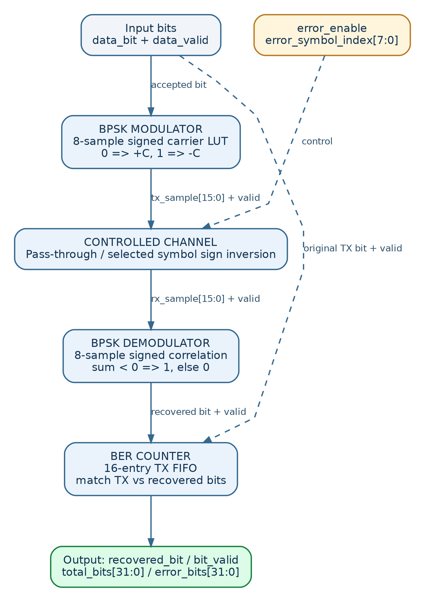
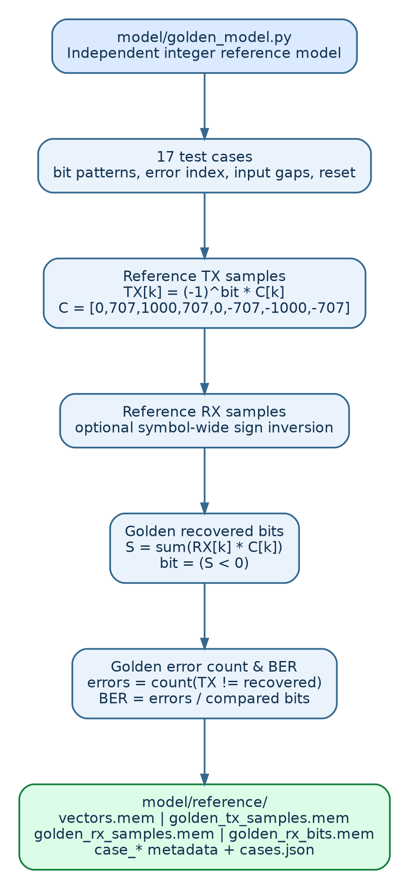
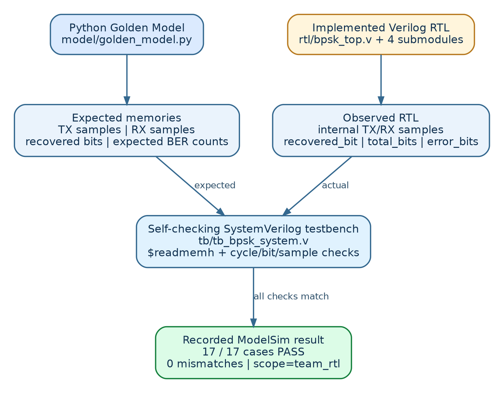
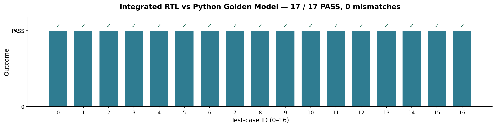
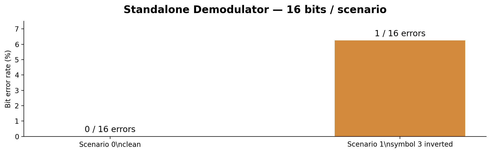

# Golden Model — Visual Verification Architecture

This file documents the implemented Python reference generator, the actual RTL comparison and the recorded ModelSim results.

## 1. Top-down RTL signal flow

## 2. Python Golden Model

The model `model/golden_model.py` generates independent reference arrays and writes `model/reference/vectors.mem`, `golden_tx_samples.mem`, `golden_rx_samples.mem`, `golden_rx_bits.mem`, plus `case_*` metadata. BPSK carrier LUT: `[0, 707, 1000, 707, 0, -707, -1000, -707]`. One bit becomes eight signed samples; selected symbols are sign-inverted. The recovered bit is `1` if the eight-product correlation is negative and `0` otherwise.

## 3. Reference versus RTL

The self-checking `tb/tb_bpsk_system.v` reads the Golden Model memories and checks the real `bpsk_top` implementation (not a reference fixture). It compares 16-bit signed TX/RX samples, recovered bits and the total/error counters.

**Recorded ModelSim result (2026-11-01):** 17/17 cases PASS; 0 mismatches; scope `team_rtl`. See `docs/results/system_integration/test_results.txt`, `test_results.csv` and `sample_trace.csv`. These results cover the defined test scenarios, not all possible input timing or channel patterns.

## 4. Separate BER evidence

The standalone demodulator verification reported a 16-bit clean scenario with BER 0% and a 16-bit inverted-symbol scenario with BER 6.25% (1/16 errors), zero RTL decision mismatches for both. See `docs/demodulator_ber_explanation.md`.

## 5. Detailed block diagrams

- [BPSK Modulator](images/detailed_modulator.png)
- [Controlled Channel](images/detailed_channel.png)
- [BPSK Demodulator](images/detailed_demodulator.png)
- [BER Counter](images/detailed_ber_counter.png)

Full technical descriptions are in `docs/detailed_design.md`.
